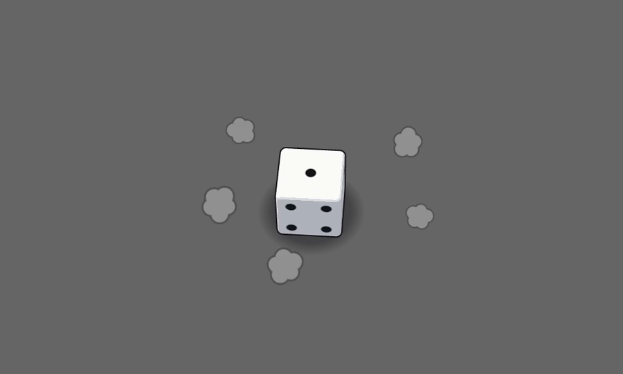

# pkt-dice

<p align="center">
  <a href="docs/media/demo.mp4"></a>
</p>

**English** · [Русский](README.ru.md)

A starter kit for a cartoon dice throw on three.js: a cube that looks hand-drawn, not 3D. White faces with black pips, a thin outline,
squash and stretch, trails behind the corners, comic impact effects, and a live tuning panel in Vue + TaoUI.
It is not a framework but a base to copy and reshape for your own game. [Watch the demo](docs/media/demo.mp4) (20 s, no sound).

**Stack:** three.js + Vue 3 + TypeScript + Vite, [TaoUI](https://www.npmjs.com/package/@1337exp/taoui).

```bash
npm install
npm run dev         # the demo: a die on a grey background
npm run build
npm run typecheck
```

## How it looks and feels

- **No table, no realism.** The die lies on an invisible floor under a camera that looks down at 52°. Only a soft shadow blob tells the eye where the floor is.
  The light is flat on purpose: three even steps per face, no highlights.
- **Drawn, not textured.** Faces, pips and the black edge are drawn in a shader from the position on the cube, with no textures or UVs, so they stay sharp at any size.
  The outline is an inverted hull in view space, so its width does not change when the die is squashed.
- **Not physics.** A throw is a storyboard built backwards from the result: the face you ask for (`value`) always lands on top.
  Squash and stretch run along the motion, whatever the cube is doing inside.
- **Three styles**, switched in the panel (`Q` cycles them). Each is just a set of values for one `tuning` object:

| Style | Motion | Lines and effects |
|---|---|---|
| **Spin** (default) | A jump with a forward tumble around one edge of the cube, aligned to the throw direction, a single hit, no bounces. The geometry twists with the rotation. | Lines from the rear corners (real arcs) and edges (a flow of air), dust puffs, optional ghost copies |
| **Toon** | A high arc with a spin and two bounces | Swirl ribbons around the path, dust, a comic burst star |
| **Sharp** | A spiral rise, the cube bends along the path, then a straight slam | Parallel speed streaks, a shockwave ring, a hold on the impact frame |

## Controls

| | |
|---|---|
| Click | throw the die to that point |
| `Space`, `Enter` | throw to a random point |
| `1`–`6` | throw and land exactly this number |
| `Q` | next style |
| `T` | the tuning panel |

## Tuning

Every knob lives in [src/tuning.ts](src/tuning.ts); the scene reads it every frame (throw parameters are read at the moment of the throw).
The **tuning panel** (`T`) has a slider for each one, grouped, and hides the knobs that the current style does not use.
Values are kept in the browser per style (only what differs from the defaults); **Reset** returns the style's defaults, **Copy** gives a ready block to paste into `tuning.ts`.

In the dev console: `__dice.ticker.speed = 0.2` slows everything down, `__dice.step()` runs one frame by hand.

The nuances (why it is built this way, and the traps found on the way) are in [docs/notes.md](docs/notes.md) (in Russian).

## How it is built

```
src/
  anim/      ease curves, Ticker (game time: tweens and waits)
  dice/
    throwPlan.ts   the storyboard: phases, path, rotation, deformation, impacts
    DiceStage.ts   renderer, camera, playback of a plan, pose history, effects
    DieView.ts     the cube body (three layers) and the ghost copies
    materials.ts   face and outline shaders: pips, edge, bend, twist
    fx.ts          floor shadow, swirl trail, rear-corner trail, impact effects
    ribbon.ts      one camera-facing line with variable width and alpha
    textures.ts    burst, puff, ring and shadow textures drawn in Canvas 2D
    faces.ts       which number is on which face
  ui/        the tuning panel
  tuning.ts  all the knobs and the three style presets
```

- **A plan** (`planThrow`) is a list of phases: wind-up, flight, contact, optional hops, settle. `plan.sample(t, pose)` returns the pose at any time, so playback, slow motion and tests all use the same function.
- **A pose** is where the cube is, how it is turned, and how it is deformed (stretch along an axis, bend, angular velocity). `DieView` applies it; the shader does what matrices cannot (bend and twist).
- **The stage** plays the plan on game time, fires effects at impacts, and keeps a short history of poses for the ghost copies.

## Your own game

```ts
const stage = new DiceStage(element, {
    onThrow: () => {},                       // hide the old result
    onResult: (value) => console.log(value), // fired on the last impact
});
stage.throwDie({ value: 5, ndc: { x: 0.3, y: -0.2 } }); // both are optional
```

1. Pick a style as the starting point in `STYLE_DEFAULTS`, or add your own set of values.
2. The look (outline, edge, pip size, shading, background, camera) is in the `Look` group of the panel.
3. Ghost copies (smear on fast spin) are built in but off: raise **Ghost brightness** to see them.
4. Another die (d20 and so on) needs its own geometry and its face shader; the throw plan is written for a cube.

## Us

Homepage: [666.io](https://666.io). If you want to help, suggest an idea or just talk, come by.
