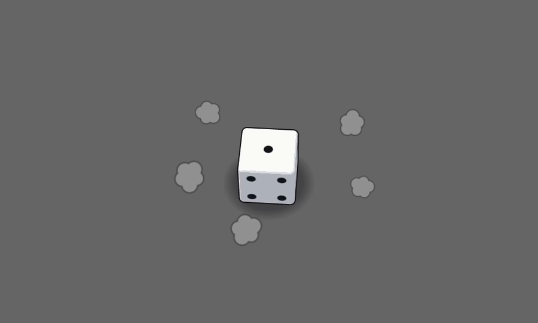

# pkt-dice

<p align="center">
  <a href="docs/media/demo.mp4"></a>
</p>

[English](README.md) · **Русский**

Заготовка для мультяшного броска кубика на three.js: кубик, который выглядит нарисованным, а не 3D. Белые грани с чёрными точками, тонкий контур,
сжатие и вытягивание, линии за углами, комиксовые эффекты удара и живая панель настроек на Vue + TaoUI.
Это не фреймворк, а основа, которую копируют и переделывают под свою игру. [Посмотреть демо](docs/media/demo.mp4) (20 с, без звука).

**Стек:** three.js + Vue 3 + TypeScript + Vite, [TaoUI](https://www.npmjs.com/package/@1337exp/taoui) и наша общая `@1337exp/pkt-threejs-blueprint` (игровое время, кривые, рендерер, указатель).
Она пока не опубликована: подключена из соседней папки (`file:../pkt-threejs-blueprint`), поэтому сначала соберите её там (`npm install && npm run build`), потом `npm install` здесь.

```bash
npm install
npm run dev         # демо: кубик на сером фоне
npm run build
npm run typecheck
```

## Как выглядит и ощущается

- **Ни стола, ни реализма.** Кубик лежит на невидимом полу под камерой, которая смотрит вниз под 52°. Где пол, глазу говорит только мягкое пятно тени.
  Свет плоский намеренно: три ровные ступени на грань, без бликов.
- **Нарисован, а не оттекстурирован.** Грани, точки и чёрная кайма рисуются шейдером по положению на кубе, без текстур и UV, поэтому чёткие при любом размере.
  Контур — «вывернутая оболочка» в пространстве камеры, так что его толщина не меняется, когда кубик сплющивается.
- **Не физика.** Бросок — раскадровка, построенная от результата к началу: заказанная грань (`value`) всегда ложится наверх.
  Сжатие и вытягивание идут вдоль движения, что бы кубик ни делал внутри.
- **Три стиля**, переключаются в панели (`Q` обходит их по кругу). Каждый — просто набор значений для одного объекта `tuning`:

| Стиль | Движение | Линии и эффекты |
|---|---|---|
| **Вертушка** (по умолчанию) | Прыжок с кувырком вперёд вокруг ребра кубика, выровненного по броску, один удар, без отскоков. Геометрия закручивается вращением. | Линии от задних углов (настоящие дуги) и рёбер (поток воздуха), облачка пыли, необязательные призрачные копии |
| **Мультяшный** | Высокая дуга с вращением и два отскока | Ленты-завихрения вокруг пути, пыль, звезда «бам» |
| **Резкий** | Спираль вверх, кубик гнётся вдоль пути, потом прямой удар сверху | Параллельные скоростные штрихи, кольцо ударной волны, замирание на ударе |

## Управление

| | |
|---|---|
| Клик | бросить кубик в эту точку |
| `Space`, `Enter` | бросить в случайную точку |
| `1`–`6` | бросить так, чтобы выпало именно это число |
| `Q` | следующий стиль |
| `T` | панель настроек |

## Настройки

Все ручки лежат в [src/tuning.ts](src/tuning.ts), сцена читает их каждый кадр (параметры броска — в момент броска).
В **панели настроек** (`T`) для каждой есть ползунок, они сгруппированы, а те, что текущему стилю не нужны, скрыты.
Значения запоминаются в браузере для каждого стиля отдельно (только то, что отличается от значений по умолчанию); **«Сбросить»** возвращает значения стиля, **«Скопировать»** даёт готовый блок для вставки в `tuning.ts`.

В консоли dev-режима: `__dice.ticker.speed = 0.2` замедляет всё, `__dice.step()` прокручивает один кадр вручную.

Нюансы (почему сделано именно так и какие ловушки встретились по дороге) — в [docs/notes.md](docs/notes.md).

## Как устроено

```
src/
  dice/
    throwPlan.ts   раскадровка: фазы, путь, вращение, деформация, удары
    DiceStage.ts   рендерер, камера, проигрывание плана, история поз, эффекты
    DieView.ts     тело кубика (три слоя) и призрачные копии
    materials.ts   шейдеры граней и контура: точки, кайма, изгиб, закрутка
    fx.ts          тень на полу, ленты-завихрения, линии за углами, эффекты удара
    ribbon.ts      одна линия-лента, всегда плашмя к камере, с переменной шириной и прозрачностью
    textures.ts    звезда, облачко, кольцо и тень, нарисованные в Canvas 2D
    faces.ts       какое число на какой грани
  ui/        панель настроек
  tuning.ts  все ручки и три пресета стилей
```

- **План** (`planThrow`) — список фаз: замах, полёт, удар, необязательные отскоки, покачивание. `plan.sample(t, pose)` возвращает позу в любой момент, так что проигрывание, замедленная съёмка и тесты используют одну и ту же функцию.
- **Поза** — где кубик, как повёрнут и как деформирован (растяжение вдоль оси, изгиб, угловая скорость). `DieView` применяет её; то, что не умеют матрицы (изгиб и закрутку), делает шейдер.
- **Сцена** проигрывает план по игровому времени, запускает эффекты на ударах и хранит короткую историю поз для призрачных копий.

## Своя игра

```ts
const stage = new DiceStage(element, {
    onThrow: () => {},                       // спрятать старый результат
    onResult: (value) => console.log(value), // на последнем ударе
});
stage.throwDie({ value: 5, ndc: { x: 0.3, y: -0.2 } }); // оба параметра необязательны
```

1. Возьми стиль за основу в `STYLE_DEFAULTS` или добавь свой набор значений.
2. Вид (контур, кайма, размер точек, тень на гранях, фон, камера) — в группе «Вид» панели.
3. Призрачные копии (смаз на быстром вращении) встроены, но выключены: подними **«Яркость призраков»**, чтобы увидеть их.
4. Другой кубик (d20 и так далее) потребует своей геометрии и своего шейдера граней; план броска написан под куб.

## Мы

Домашняя страница: [666.io](https://666.io). Хочешь помочь, предложить идею или просто поговорить — заходи.
